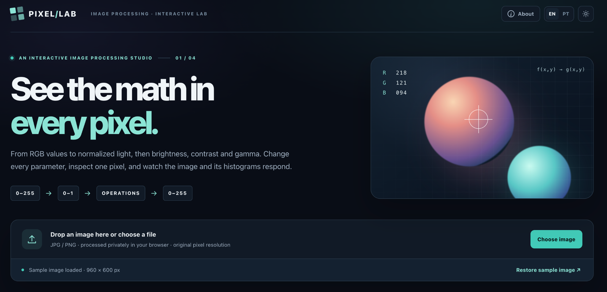

# Pixel Lab — Interactive Image Processing

An interactive image processing laboratory built for the **Image Processing** course in Computer Engineering at [ENIDH](https://www.enautica.pt/). Upload an image, transform its pixel intensities, and see how each operation changes the image and its histograms.

## What you can do

- Drag and drop a JPG/PNG image, choose a file, or use the built-in sample.
- Compare the original RGB image with a grayscale preview.
- Process the image in either **RGB** or **grayscale** mode.
- Adjust brightness, contrast, and gamma individually or combine all three in the final result.
- Switch between **All operations**, **Brightness**, **Contrast**, and **Gamma** tabs to study each step.
- Hover over or click a pixel to trace its original, normalized, processed, and final values.
- Compare original and final images in a full-screen view, then download the final PNG.
- Inspect RGB-channel and luminance histograms before and after each selected step.
- Switch between English and Portuguese, and between dark and light themes. Dark mode and English are the defaults.

## Processing pipeline

The application keeps the original image at its pixel resolution and applies the following sequence to each pixel:

    Original RGB [0, 255]
        → Normalize to [0, 1]
        → Select RGB or grayscale
        → Brightness
        → Contrast
        → Gamma
        → Convert to final RGB [0, 255]

| Step | Formula | Meaning |
| --- | --- | --- |
| Normalize | f = I / 255 | Put each 8-bit channel on the [0, 1] scale. |
| Grayscale (when selected) | Y = 0.2126R + 0.7152G + 0.0722B | Compute luminance from normalized RGB. |
| Brightness | g = f + β | Shift intensities up or down. |
| Contrast | g = α(f − 0.5) + 0.5 | Expand or compress intensities around the midpoint. |
| Gamma | g = f^γ | Curve midtones: γ < 1 lightens them; γ > 1 darkens them. |
| Clipping | g = min(1, max(0, g)) | Keep values in [0, 1] after each operation. |
| Output | I = round(255 × g) | Convert the processed values back to 8-bit channels. |

The final image always applies **brightness → contrast → gamma** in that order, using the current values of all three controls. The operation tabs change the step being explained and compared in the histograms; they do not disable the other adjustments in the final image.

The histograms show frequency by intensity from 0 to 255. The RGB plots overlay the red, green, and blue channels; the luminance plots use the grayscale weighting above. Fully transparent pixels are excluded from histogram counts.

## Run locally

No installation, build step, server, or external library is required:

1. Download the project HTML file, **index2.html**.
2. Open it in a modern browser.
3. Use the sample image or upload your own JPG/PNG file.

Images are processed in your browser and are not uploaded to a server. If publishing the project with GitHub Pages, name the HTML entry file **index.html**.

## Add this README to the project

Place these files alongside your existing HTML file:

    your-project/
    ├── index2.html
    ├── README.md
    └── assets/
        └── pixel-lab-screenshot.png

The screenshot path in this README is relative, so the image will display on GitHub when **README.md** and the **assets** folder are committed together.

## Technologies

HTML, CSS, JavaScript, and the Canvas API. The site is a self-contained HTML application.

## Credits

Developed by **Alberto Junior, Frederico Roque, and Lucas Alemão**, with the help of AI, for the Image Processing course at ENIDH.
